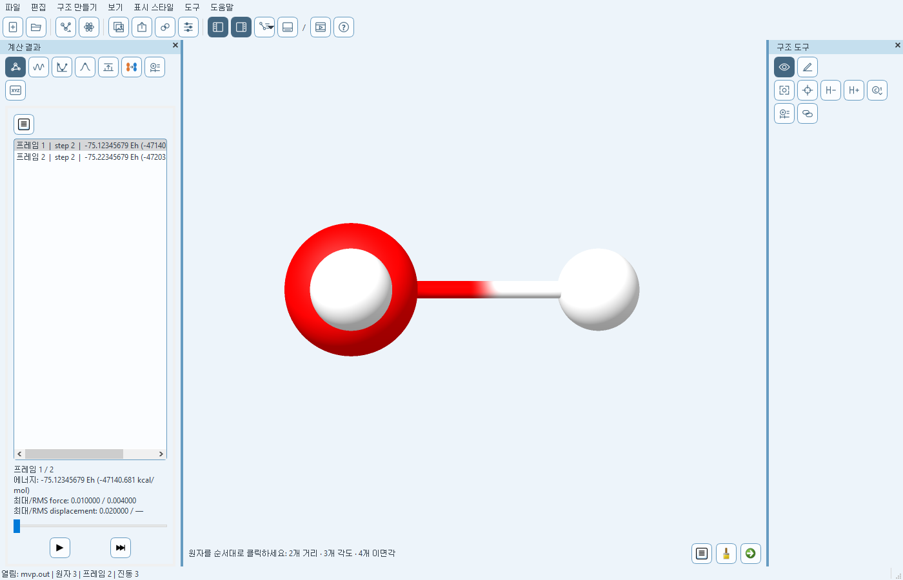
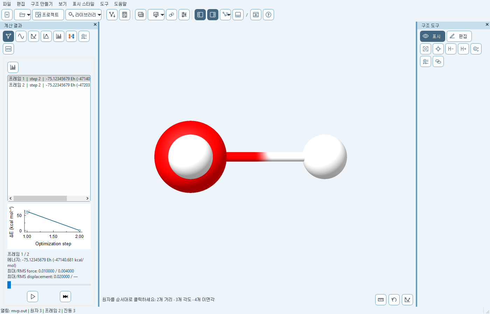
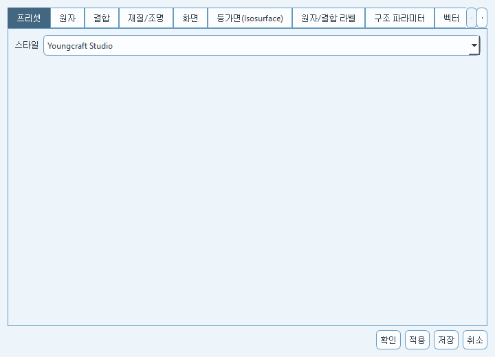
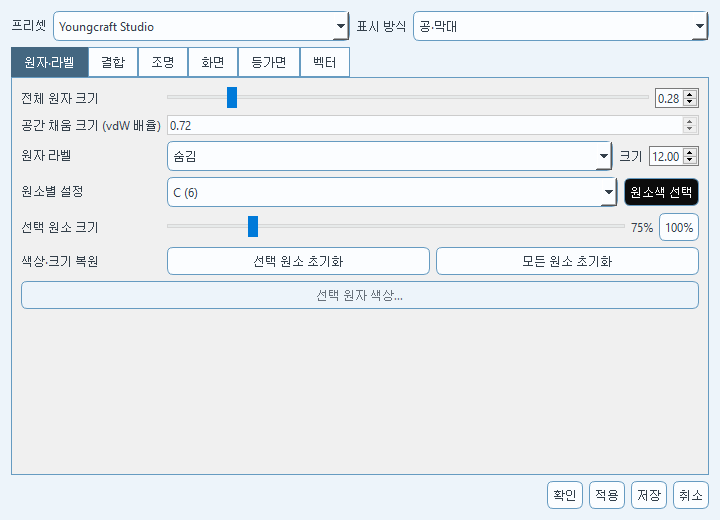
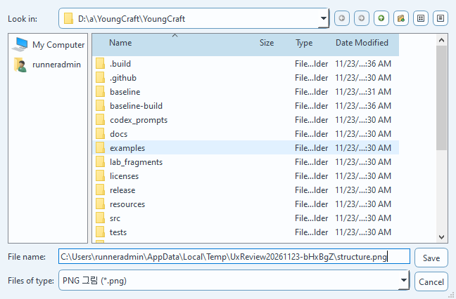
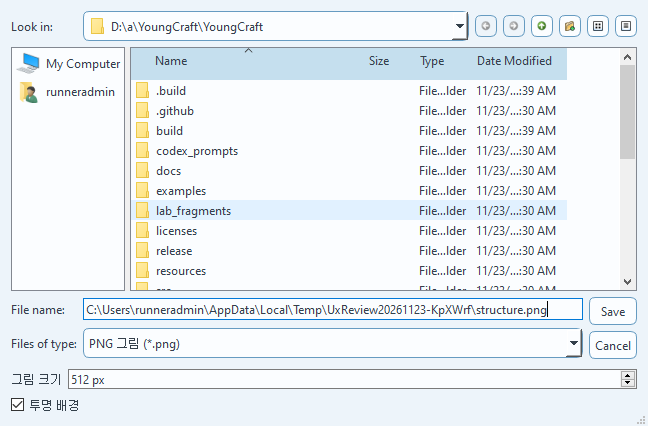

# 11월 UI·UX 개선 결과 — 2026-11-23

기준 버전 `0753d1a`와 개선 버전을 같은 Windows GUI 하네스로 비교했다. 사전 지정한 20개 작업의 실제 마우스 클릭 합계는 **37→25회**, 작업당 평균은 **1.85→1.25회(32.4% 감소)**다. 명령 진입·선택·설정과 실제 저장을 함께 포함한 표본이며, 모든 연구 작업의 시작부터 계산 완료까지 평균을 뜻하지 않는다.

- 메인 화면: 프로젝트·라이브러리 직접 버튼, 열기·저장 분할 버튼, 내보내기 메뉴 통합, 표시·편집 탭 이름 노출.
- 결과 분석: 최적화·Scan 그래프를 패널에 표시하고 구조 선택과 연결, 허수 진동·GIF·HOMO/LUMO 빠른 조작 유지·개선.
- 구조 편집: 프래그먼트·선택 구조 변환 직접 접근, 측정만 할 때 편집 복사본 생성 방지, 스타일 10개 탭을 6개로 통합.
- 아이콘·문구: 계산·재생, 복사·저장, Scan·IRC를 구분하고 기능명·접근성 이름·기존 단축키 보존.
- 작은 창·DPI: 측정 행 높이 자동 조정, 스타일 페이지 스크롤, TD-DFT 도구 자동 줄바꿈·스크롤과 색상 버튼 대비 수정.

## 클릭 실측

각 수치는 실제 `QTest::mouseClick` 1회씩 집계했다. 시작 데이터를 준비하는 코드, 글자 입력, 작업 후 창 닫기는 제외했다. 양쪽 모두 같은 시작·도달 조건을 확인하며, 기존 보기→고해상도 출력 등 가장 짧은 메뉴 경로를 기준으로 삼았다. 1클릭인 기존 기능도 분모에 포함했다.

| 작업·도달점 | 이전 | 개선 |
| --- | ---: | ---: |
| 파일 선택창 열기 | 1 | 1 |
| 이미지 저장 선택창 열기 | 2 | 1 |
| XYZ 저장 선택창 열기 | 3 | 2 |
| 프로젝트 라이브러리 표시 | 2 | 1 |
| 프래그먼트 라이브러리 표시(삽입 전) | 2 | 1 |
| 이미지 실제 클립보드 복사 | 1 | 1 |
| 마지막 프레임→첫 프레임, 3D 좌표 적용 | 1 | 1 |
| 허수 모드 선택과 진동 재생 | 1 | 1 |
| Scan 지점 선택과 구조 적용 | 1 | 1 |
| IRC 지점 선택과 구조 적용 | 1 | 1 |
| 좌표→진동 패널 | 1 | 1 |
| TD-DFT→NTO 분석창(표면 생성 전) | 1 | 1 |
| 오비탈→관리창(표면 생성 전) | 1 | 1 |
| xTB 옵션창(실행 전) | 1 | 1 |
| MM 옵션창(실행 전) | 1 | 1 |
| 최적화 그래프 지점 선택과 구조 적용 | 2 | 1 |
| Scan 그래프 지점 선택과 구조 적용 | 2 | 1 |
| 스타일 창에서 원자 크기 변경 | 2 | 1 |
| 프리셋 변경 후 원자 설정으로 복귀 | 4 | 2 |
| 투명 PNG 저장 완료(512px·600dpi, 파일명 키 입력 제외) | 7 | 4 |
| **합계 / 평균** | **37 / 1.85** | **25 / 1.25** |

최근 파일은 하위 메뉴를 hover로 열 수 있어 최소 클릭 수가 2→2회다. MM·xTB·복사·진동·기존 분석 바로가기는 이미 1클릭이므로 그대로 유지했다. XYZ는 출력 형식 선택이 남아 2클릭, 완전한 이미지 저장은 저장창과 옵션 조작 때문에 4클릭이다. 이미지 해상도·배경을 저장창 안에 합쳐 추가 확인창을 없앴다. 기본 Ctrl+S 저장 형식 선택과 CIF 경로는 보존했다.

## 화면 비교

가공하지 않은 원격 Windows 캡처다. 메인 화면은 같은 1400×900 창과 같은 데이터다.

| 이전 | 개선 |
| --- | --- |
|  |  |
|  |  |
|  |  |

[편집 이전](ux-review-20261123/before-editor.png) · [편집 개선](ux-review-20261123/after-editor.png) · [200% DPI 작은 분석 창](ux-review-20261123/after-200pct-compact.png). 아이콘 대응·크기·접근성 규칙은 [공통 아이콘 문서](UX_ICONS_20261123.md)에 기록했다. 인지도에 대한 사용자 실험은 하지 않아 인지율 수치는 제시하지 않는다.

## 필수 작업 회귀 범위

| 작업 | 검증 내용 |
| --- | --- |
| Gaussian·ORCA | 실제 공개 결과 10개 GUI 열기·결과/구조 연결, 전체 공개 파서·CIF 코퍼스 별도 검사 |
| 최적화·프레임 | 목록·슬라이더·그래프 선택, 좌표·에너지·재생 연동 |
| 허수 진동 | 모드 선택·자동 재생·속도·페이지·GIF 복사 |
| Scan·IRC | 목록·그래프·화살표 탐색과 일치하는 구조·측정값 |
| TD-DFT·NTO | 전이 선택·스펙트럼·설정 유지·NTO 표면·상태별 활성화 |
| HOMO·LUMO | 오비탈 컨트롤·렌더링·캐시·분리 창·FCHK/CUBE·외부 도구 오류 처리 |
| 편집·라이브러리 | 원자·결합·프래그먼트·리간드 교체·선택·undo·키보드 |
| MM·xTB | 제약·전하·중지/재개·결과 적용·왜곡 결과 방지, 실제 런타임 별도 검사 |
| 복사·저장·PPTX | 투명 PNG 파일·크기·해상도·클립보드·내보내기·PPTX XML/미디어 생성 |
| 문서·프로젝트 | 문서 독립성·백그라운드 로드·탭·프로젝트·툴바 문맥·설정 보존 |

작은 820×640·일반 1400×900·물리 4K에 대응하는 창을 100/150/200% 배율에서 검증했다. 요청 크기와 실제 창 크기를 대조했고, 200%에서는 추가로 논리 546×375의 작은 창을 검사했다. TD-DFT 6개 도구를 각각 스크롤해 가림 없이 접근 가능한지 확인했다. 의도된 스크롤 내용의 잘림은 오류 집계에서 제외하며, 좁은 편집 패널의 일부 설정에는 가로·세로 스크롤이 필요하다. 화면보다 큰 조건은 고정 크기 가상 창으로 검사했으므로, 일반 창의 자동 크기 제한·화면 안 배치나 실제 4K 모니터의 육안 시험까지 입증하지는 않는다.

## 검증 결과와 한계

- [최종 Windows CI](https://github.com/Skylark51/YoungCraft/actions/runs/45118235288), 검증 커밋 `5448fe4`: Release 빌드·계산 CTest 10/10, GUI 131 PASS·외부 입력 4 SKIP, 오비탈 14 PASS·외부 입력 2 SKIP. 실패·시간 초과 없음.
- 같은 CI의 기준 버전 측정과 100/150/200% DPI 10개 창 조건 통과, 레이아웃 겹침·잘림 검사 0건. [클릭 원자료 비교](ux-review-20261123/click-comparison.json)에는 20개 시작·도달 조건을 모두 수록했다.
- 로컬 콘솔 CTest 9/9, 실제 MM 런타임 제약 검사 7/7, 단일 실행 파일 회귀 12/12 통과. GUI는 원격 Windows에서만 실행했다.
- 포터블 206개 파일의 dist·ZIP 체크섬 일치, 단일 실행 파일 압축 해제·검증 통과. [배포 해시](ux-review-20261123/package-verification.json) 기록.
- 자동 배포의 기존 Windows 8.3 임시 경로 오류도 수정했다. PowerShell 5·7의 긴 경로·짧은 별칭 4개 조합에서 실제 매니페스트 경로·크기·해시를 검사했다.
- 오프라인 검증 도구의 PowerShell 5 UTF-8 BOM 문제를 수정했다. 두 PowerShell 버전에서 원시 입력 바이트와 외부 런타임 없는 MM 120회 반복을 확인했으며, MM 계산 코드는 변경하지 않았다.
- Windows SSH 도우미의 빠른 IPC 응답·연결 종료 처리를 보완했다. [전용 Windows 검사](https://github.com/Skylark51/YoungCraft/actions/runs/45131011128)에서 IPC 256회·실제 키 복호화 8회 연속 통과했다. 단일 EXE의 경로 검사는 긴 이름·8.3 별칭을 같은 실제 경로로 비교하며, 강제 별칭 환경에서 12개 회귀가 모두 통과했다.
- 배포 MM 의존성을 검증된 RDKit 2026.3.6·PyInstaller 6.22.3으로 고정하고 회귀·배포가 같은 요구사항을 사용하도록 맞췄다. 자동 최신 설치에서 발견한 거리 제약 오차를 차단하며 기존 계산 코드와 허용 오차는 유지했다.
- C드라이브 `%LOCALAPPDATA%/Programs/Youngcraft Portable` 설치 완료. 사용자 설정 1개와 개인 파일 해시 보존, 바탕화면 `YoungCraft.exe` 하나로 갱신하고 별도 Youngcraft 바로가기 0개 확인. 설치·바탕화면 압축 해제본의 앱 해시는 빌드·배포본과 일치한다.

외부 입력이 없는 실제 원격 Gaussian 서버·자동 CHK, 개인 메커니즘 프로젝트, 별도 실제 Scan 폴더 검사는 SKIP 사유를 보존한다. 공개 실제 Scan 파일은 별도 GUI 코퍼스로 검사한다. PowerPoint 앱에서의 슬라이드 재생, 사용자 대상 아이콘 인지도 실험은 수행하지 않았다. 기존 상태 표시용 메뉴 항목에 새 계산 기능을 만들지는 않았다.

로컬에서는 앱·GUI·SSH 보조 창을 실행하지 않았다. 기존 단축키·설정 키·파서·화학 데이터 형식은 유지했고, 개인 예제·기존 미커밋 파일은 보존했다. 포터블은 승인된 패키징·설치·바탕화면 갱신 스크립트로 배포한다.
