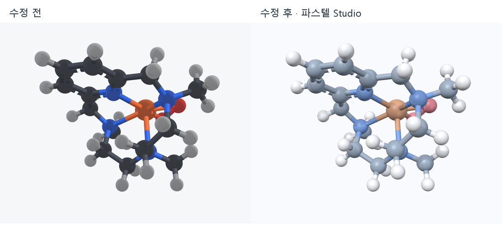
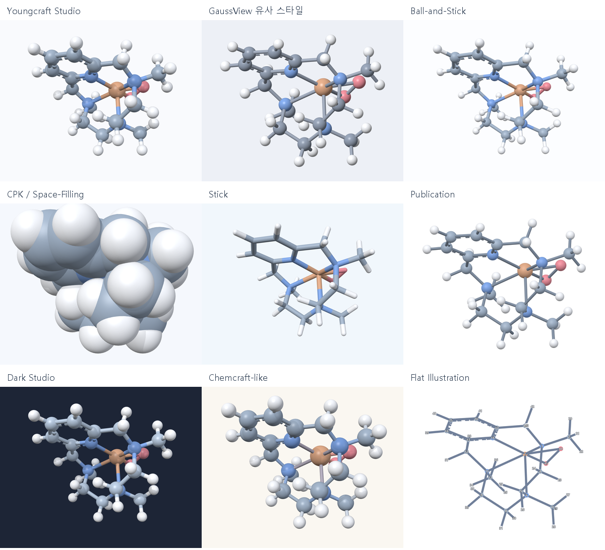

# 렌더링 품질·파스텔 preset 개선 — 2026-10-16



비교 대상은 프로젝트의 `12-mtp.cjson`과 `peroxo-eta2.cjson` 좌표를 사용하는 Fe–12-MTP–peroxo 시각화 fixture다. 원본 fragment와 화학 모델은 수정하지 않았다. 같은 1000×800 viewport, 카메라 fitting과 회전 입력으로 실제 OpenGL framebuffer를 캡처했다. 왼쪽은 수정 전 소스를 빌드한 결과, 오른쪽은 새 Studio preset이다. 팔레트와 렌더링 수정이 모두 반영된 비교다.

## 확인한 원인과 변경

| 지점 | 원인 | 변경 |
|---|---|---|
| `MoleculeView_GL.cpp` 구 메시 | 삼각형 winding과 바깥쪽 법선이 반대였다. `GL_BACK` culling으로 앞면이 제거되어 뒤쪽 반구가 보였다. | 고·중·저 해상도 구 메시 모두 바깥쪽에서 반시계 방향으로 생성한다. GPU에 업로드된 세 메시를 읽어 법선과 삼각형 방향을 확인한다. |
| `MoleculeShaders.inc` 조명 | 주변광 설정에 별도의 상수 밝기가 더해지고, 어두운 원자색에 하이라이트가 강하게 착색됐다. | 주변광 강도에 비례하는 hemisphere 조명과 절제된 중성 하이라이트를 사용한다. 법선의 inverse-transpose 변환은 기존 코드가 올바르므로 유지했다. |
| 같은 셰이더의 깊이 효과 | 원근 투영 후의 비선형 depth가 대부분 1에 가까워 분자 전체가 비슷하게 흐려졌다. | 표시된 원자의 카메라 방향 깊이를 분자 크기로 정규화한다. 앞뒤 원자를 구별하고 zoom·투영 clipping 범위에 따른 변화를 줄인다. |
| `MoleculeView_Scene.cpp` | 직교 투영에서도 각 원자에서 유한 거리의 눈으로 향하는 방향을 사용했다. | 직교 투영에는 일정한 view direction을 사용한다. 카메라 기준 조명 옵션으로 회전 중에도 조명이 따라간다. 0벡터 광원 입력에는 안전한 기본 방향을 사용한다. |
| `MoleculeView_Shadows.cpp` | 모든 결합을 중심의 원통 하나로 그려 다중·점선 결합의 그림자가 화면 형상과 달랐다. | 색상 pass와 같은 결합 형상을 사용한다. depth 상태를 명시하고 polygon offset·5×5 PCF로 그림자 경계를 완화한다. FBO가 불완전하면 그림자를 사용하지 않는다. |
| `MoleculeView_AtomsBonds.cpp` | 밝은 원소색을 배경 밝기에 따라 임의로 어둡게 했다. 공간 채움 반지름은 0.72배로 고정되어 있었다. | 설정된 파스텔 색을 그대로 사용한다. CPK에는 vdW 배율을 적용하고, Stick은 일정한 반지름과 기본 단일 튜브를 사용한다. |

원자는 구, 결합은 원통을 사용하는 기존 OpenGL 3.3 경로를 확장했다. 화면·PNG·투명 캡처는 같은 셰이더와 framebuffer 경로를 사용한다. 이 작업은 주변 차폐(SSAO)나 광선 추적을 추가한 것은 아니다.

## 실제 선택 가능한 preset



전체 원소에 밝은 파스텔 계열 팔레트를 적용했다. 주요 원소는 탄소 청회색, 질소 연한 파랑, 산소 부드러운 분홍빛 빨강, 철 살구색이다. 개인 원소색·개별 원자색 override는 계속 우선한다.

| preset | 화면상의 구분 |
|---|---|
| Youngcraft Studio | 밝은 배경, 중간 크기의 원자, 원소색 결합, 두 광원과 부드러운 접촉 그림자 |
| GaussView 유사 스타일 | 중성 회청색 배경, 작은 원자, 회색 결합, 직교 투영, 한 광원의 절제된 광택 |
| Ball-and-Stick | 더 작은 원자, 원소색 결합, 낮은 광택, 밝은 배경 |
| CPK / Space-Filling | 결합을 숨기고 실제 vdW 반지름 1.0배로 공간 채움; 부드러운 그림자 |
| Stick | 원자와 결합의 반지름을 맞춘 연속 튜브; 기본적으로 결합 차수를 여러 튜브로 분리하지 않음 |
| Publication | 흰 배경, 가는 단색 결합, 작은 원자, 낮은 광택, 직교 투영 |
| Dark Studio | 어두운 청색 배경, 밝은 파스텔 원소색, 그림자와 약한 깊이 효과 |
| Chemcraft-like | 따뜻한 밝은 배경, 큰 원자와 가는 결합, 두 원자색을 혼합한 결합색 |
| Flat Illustration | 조명을 끈 가는 그림과 번호 라벨; 기존 3D 좌표를 직교 투영하며 2D 구조 좌표를 생성하지 않음 |

GaussView 유사는 [Gaussian의 Display Format 안내](https://gaussian.com/wp-content/uploads/dl/gv6.pdf)를 참고하는 일반적 분자 표시 방식의 preset이며, GaussView의 정확한 복제나 파일 호환 기능을 뜻하지 않는다.

## 설정과 UI

- `표시 스타일` 메뉴와 스타일 편집기는 같은 preset 목록을 사용하고 선택 즉시 갱신한다. 메뉴를 열면 현재 이름에 체크 표시가 나온다.
- 과거의 `출판용 1–3`, `2D 스타일 1–7`, `Chemcraft 참조`, `Classic CPK`, `Dark` 등은 새 이름으로 해석한다. 동일한 결과의 별도 이름은 새 목록에 중복해서 표시하지 않는다.
- 저장된 실제 색상·크기·표시 방식 snapshot을 읽으므로 과거 이름이 새 이름으로 바뀌어도 개인 값은 덮어쓰지 않는다. 빈 원소색 override도 유지한다.
- 기존 설정에는 카메라 기준 조명 옵션이 없으므로 이전의 월드 기준 조명을 기본으로 복원한다. 이전 공간 채움 배율은 0.72로 복원한다. 새 preset 선택부터 새 기본값을 적용한다.
- 편집기의 원자 탭에 공간 채움 vdW 배율, 조명 탭에 카메라 기준 조명, 결합 탭에 다중 결합 차수 표시를 추가했다. 이 값들도 미리보기·저장·복원한다.
- 새 파스텔 기본을 사용하려면 **표시 스타일 → Youngcraft Studio**를 선택한다. `사용자 지정`을 고르면 편집 중의 값을 보존한다.

## 빌드와 검증

MSVC 2022와 Qt 6.8.3 Release로 앱·캡처 도구·관련 테스트를 빌드했다. Windows OpenGL에서 셰이더 링크, 세 구 메시의 방향, 구 표면 하이라이트, 앞뒤 깊이 효과와 zoom 일관성, 그림자 FBO와 투명 캡처를 확인했다. 메뉴·편집기의 즉시 적용, 저장, 기존 설정 복원도 확인했다. 로그는 `model-tests.txt`, `gui-tests.txt`에 있다.

최종 결과: QtTest 모델 16 passed, Windows GUI 11 passed, 실패·skip 0. 숫자에는 각 suite의 초기화·정리 항목이 포함되어 있다.

검토용 실행 파일: `../../.build/render-quality/app/Youngcraft.exe`.

이 실행 폴더는 렌더링 검토용 빌드다. 별도의 portable MM/xTB 런타임 패키지는 포함하지 않는다. 기존 루트 `Youngcraft.exe`, `dist/Youngcraft.exe`, `Youngcraft-portable.zip`은 수정 전후 SHA-256이 동일하다.

개발 명령 프롬프트에서 재현:

```bat
cmake -S . -B build-editor-final -DYOUNGCRAFT_BUILD_RENDER_PREVIEW=ON -DYOUNGCRAFT_RUNTIME_OUTPUT_DIRECTORY:PATH=.build/render-quality/app
cmake --build build-editor-final --target Youngcraft render_quality_preview test_smoke test_model --parallel 6
build-editor-final\render_quality_preview.exe . docs\render-quality-20261016\presets
```

옵션으로 preset 이름 하나를 마지막 인수에 전달할 수 있다. 캡처 도구는 앱 설정을 읽거나 쓰지 않으며, 클립보드를 사용하지 않는다.

변경 전 소스 백업: `../../.build/render-quality/before-source.zip`. 소스 차이: `changes.diff`. 분자 모델·파싱·계산 알고리즘은 변경하지 않았다.

변경 파일의 전체 목록은 `modified-files.json`에 있다. 렌더링 외에는 `StyleManager.{h,cpp}`의 preset·저장 처리, `MainWindow_Menus.cpp`의 목록·선택 표시, `StyleEditorDialog.{h,cpp}` 및 `styleeditor/StyleEditor_{Atoms,Bonds,Lighting}.cpp`의 관련 조작부를 변경했다. `CMakeLists.txt`와 `tools/render_quality_preview.cpp`는 배포 실행 파일을 덮어쓰지 않는 빌드와 재현 캡처를 제공한다. `tests/model/test_model.cpp`, `tests/smoke/test_smoke.cpp`는 위 회귀를 확인한다.
