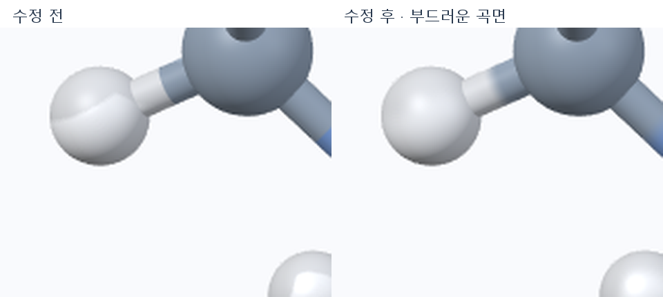
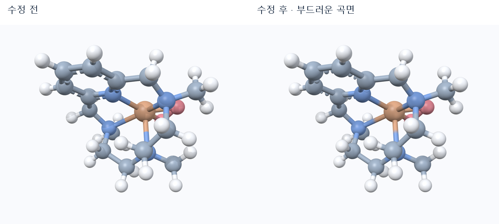

# 곡면·연결부 매끄러움 개선 — 2026-10-16

왼쪽은 파스텔 preset 적용 직후의 이전 렌더러, 오른쪽은 이번 수정 결과다. 같은 분자·preset·카메라·viewport의 같은 영역을 동일한 방식으로 확대했다. 원본 비교는 `before-after.png`, 수정 후 원본은 `presets/preset-00.png`에 있다.

## 끊겨 보인 원인

1. **구 표면의 잘못된 자기 그림자:** 색상 pass는 화면 크기에 따라 간략화된 구를 사용하지만 그림자 pass는 항상 더 촘촘한 구를 사용했다. 간략화된 표면이 그림자 구 안쪽에 들어가 각진 어두운 조각이 생겼다. 동일 fixture에서 그림자를 껐을 때 조각이 사라지는 것도 확인했다.
2. **단단한 그림자 경계:** 깊이 값을 보간한 뒤 이진 비교하던 필터는 부드러운 차폐 경계를 만들기 어려웠다. 인접 원자·결합의 그림자 경계도 구를 잘라 놓은 듯 보일 만큼 좁았다.
3. **곡면 해상도:** 구의 최대 분할은 48×32, 결합 원통의 둘레는 28분할이었다. 확대하면 실루엣과 그림자에서 각이 드러날 수 있었다.
4. **결합 중앙 경계와 열린 끝:** 원소색 결합을 두 개의 원통으로 나누고 중앙에서 색을 즉시 바꾸었다. 다중 결합이나 원자보다 굵은 결합에서는 원통의 열린 끝도 노출될 수 있었다.

## 변경

- `MoleculeView_GL.cpp`: 구를 저/중/고 해상도 32×24 / 64×48 / 128×96으로 만들고 원통 둘레를 64분할로 늘렸다. 그림자 텍스처는 각 깊이 비교 결과를 보간하도록 설정했다.
- `MoleculeView_AtomsBonds.cpp`: 화면상의 반지름으로 구 메시를 선택하는 공통 경로를 만들었다. 그림자와 화면이 같은 경로를 사용한다. 결합을 연속된 하나의 원통으로 그리고 중앙 20% 구간의 원소색을 부드럽게 전환한다. 단색·혼합색 preset은 그대로 단색이다.
- 노출되는 결합 끝에는 둥근 cap을 추가했다. 점선은 둥근 끝을 원래 dash 구간 안에 넣어 gap을 유지한다. dash 위치도 설정된 길이·gap 주기를 사용한다. 원자에 완전히 묻히는 끝에는 추가 cap을 만들지 않는다.
- `MoleculeView_Shadows.cpp`: 원자도 색상 pass와 같은 메시와 모델 변환으로 그린다.
- `MoleculeShaders.inc`, `MoleculeView_Scene.cpp`: 깊이 비교를 먼저 수행하는 필터, 가중치가 있는 9×9 soft-shadow 커널, 구조 좌표 기준 0.10의 반그림자 폭을 적용했다. 넓은 필터가 기울어진 자기 표면을 차폐로 잘못 해석하지 않도록 receiver의 국소 깊이 기울기를 보정했다.
- `MoleculeView.h`: 위 공통 렌더 함수와 결합 색 전환 인수를 선언했다.
- `tools/render_quality_preview.cpp`: 원인 비교용 `--no-shadows` 옵션을 추가했다.

파스텔 팔레트·preset 설정과 분자 좌표·화학 연결 정보는 변경하지 않았다. 세 메시 수준을 화면 크기에 맞춰 선택하며, 물체를 모두 최고 해상도로 그리지는 않는다. 구와 결합은 기존 OpenGL 메시 렌더 경로를 사용한다.

## 검증

MSVC 2022 + Qt 6.8.3 Release 빌드 성공. 실제 Windows OpenGL에서 아래 6개 동작을 검사했으며, QtTest 초기화·정리를 포함해 **8 passed, 0 failed, 0 skipped**다. 로그: `gui-tests.txt`.

- 세 메시 수준의 고립된 구에 그림자를 켜도 각진 자기 그림자가 생기지 않는지 확인.
- 다른 원소색 결합의 중앙 색이 연속적으로 변하는지 픽셀 검사.
- 결합보다 작은 원자에서도 노출된 원통 끝이 채워지는지 확인.
- 둥근 점선 cap이 설정한 빈 간격을 메우지 않는지 확인.
- 기존 outward winding·법선·하이라이트·깊이 효과·투명 캡처 확인.
- 메뉴·편집기의 preset 적용과 실제 Gaussian fixture 로딩 확인.

위 새 조건들은 `tests/smoke/test_smoke.cpp`의 `rendersContinuousBondsAndCleanSphereShadows`에서 검사한다. 나머지 관련 기존 검사도 함께 실행했다.

검토용 실행 파일: `../../.build/render-quality/app/Youngcraft.exe`. 기존 배포 파일을 덮어쓰지 않고 이 빌드를 갱신했다. 루트·dist 실행 파일과 기존 portable ZIP의 SHA-256은 그대로다.

변경 전 소스: `../../.build/render-smoothing/before-source.zip`.
이번 소스 차이와 파일 목록: `changes.diff`, `modified-files.json`.

